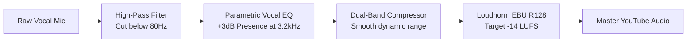

# Post-Production & Audio/Cut Automation (Whisper + FFmpeg + Sero)

This skill provides step-by-step procedures, scripts, and production workflows for automating video post-production inside Google Anti-gravity:
1. **Whisper Transcription & Karaoke Alignment**: Automatic speech-to-text with word-level timestamps.
2. **Sero & Dead-Air Cut Automation**: Detecting pauses and silence to perform automated jump cuts, keeping pacing tight for kids.
3. **FFmpeg Broadcast Audio Mastering**: Parametric EQ, compression, de-essing, audio ducking, and EBU R128 (-14 LUFS) normalization for YouTube.

---

## 1. Automated Whisper Transcription & Word-Level Timestamps

Use Whisper (via CLI or `openai-whisper`) to extract precise word boundaries for sing-alongs:

```bash
# Run Whisper with word-level timestamps output to JSON
whisper vocal_track.wav --model base --language en --output_format json --word_timestamps True --output_dir ./subtitles
```

### Python Extraction Pattern:
```python
import json

def parse_whisper_word_cues(json_path: str):
    """Parses Whisper output into millisecond-accurate karaoke cues."""
    with open(json_path, 'r', encoding='utf-8') as f:
        data = json.load(f)

    words = []
    for segment in data.get("segments", []):
        for w in segment.get("words", []):
            words.append({
                "word": w["word"].strip(),
                "start": round(w["start"], 3),
                "end": round(w["end"], 3),
                "duration": round(w["end"] - w["start"], 3)
            })
    return words
```

---

## 2. Sero / Dead-Air & Silence Cut Automation

Preschoolers have shorter attention spans. Any dead air (>300ms) causes drop-off. Automate silence detection and cutting using FFmpeg's `silencedetect` and segment concatenation:

```bash
# Detect silences below -35dB lasting longer than 0.3 seconds
ffmpeg -i raw_take.mp4 -af "silencedetect=noise=-35dB:d=0.3" -f null -
```

### Automated Sero Python Script:
```python
import subprocess
import re

def remove_dead_air(input_video: str, output_video: str, silence_threshold_db: int = -35, min_silence_duration: float = 0.35):
    """
    Analyzes video, detects awkward pauses, and generates a jump-cut video with tight pacing.
    """
    # 1. Detect silence intervals
    cmd = [
        "ffmpeg", "-i", input_video,
        "-af", f"silencedetect=noise={silence_threshold_db}dB:d={min_silence_duration}",
        "-f", "null", "-"
    ]
    result = subprocess.run(cmd, capture_output=True, text=True)
    
    # Parse silence_start and silence_end
    starts = [float(x) for x in re.findall(r"silence_start: ([\d\.]+)", result.stderr)]
    ends = [float(x) for x in re.findall(r"silence_end: ([\d\.]+)", result.stderr)]
    
    # 2. Build select filter to keep speech intervals only
    # Alternatively use FFmpeg silenceremove filter
    silence_filter = f"silenceremove=stop_periods=-1:stop_duration={min_silence_duration}:stop_threshold={silence_threshold_db}dB"
    
    cut_cmd = [
        "ffmpeg", "-y", "-i", input_video,
        "-af", silence_filter,
        "-c:v", "libx264", "-pix_fmt", "yuv420p", "-c:a", "aac",
        output_video
    ]
    subprocess.run(cut_cmd, check=True)
    return output_video
```

---

## 3. FFmpeg Studio Audio Mastering Chain (-14 LUFS)

Preschool vocals must be bright, warm, and audible on tablet and phone speakers without harsh sibilance:



### Complete FFmpeg Filter Graph:
```bash
ffmpeg -i voice.wav -af \
"highpass=f=80,\
equalizer=f=3200:t=q:w=1.2:g=3.5,\
equalizer=f=250:t=q:w=1.0:g=-2.0,\
acompressor=threshold=-18dB:ratio=3.5:attack=15:release=120,\
loudnorm=I=-14:LRA=7:TP=-1.5" \
-c:a pcm_s16le vocal_mastered.wav
```

### Audio Ducking Formula (Vocals over Background Music):
```bash
# Duck BGM track whenever vocals are active, then mix cleanly
ffmpeg -i vocals.wav -i bgm.wav -filter_complex \
"[1:a]volume=0.22,afade=t=in:ss=0:d=1.0,afade=t=out:st=58.5:d=1.5[bgm]; \
 [0:a][bgm]amix=inputs=2:duration=first:dropout_transition=2[aout]" \
-map "[aout]" -c:a aac -b:a 256k master_mix.aac
```
