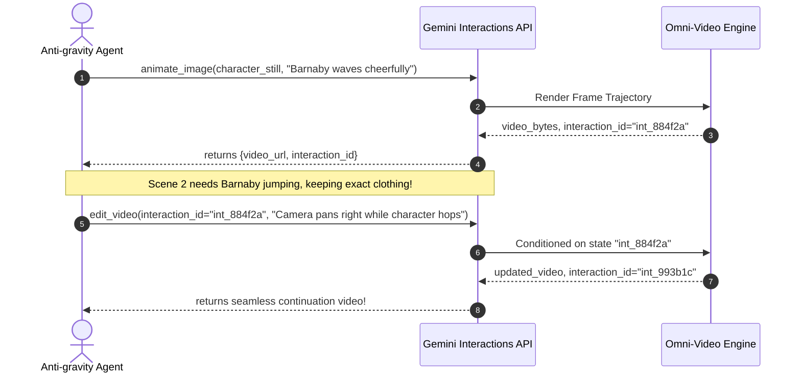

# Stateful Video Direction & AI Generation (Omni-Video / Gemini Interactions API)

This skill provides comprehensive instructions for directing, generating, and iteratively editing AI videos using Gemini's **stateful Interactions API** inside Google Anti-gravity.

Unlike stateless text-to-video APIs that recreate scenes from scratch on every turn (destroying character identity and lighting continuity), the Gemini Interactions API chains **Interaction IDs** server-side. This allows AI directors to animate character stills, perform targeted video in-painting, alter camera trajectories, and maintain 100% character continuity across scenes.

---

## 1. Core Tool Interfaces

The `omni-video` skill exposes four primary tools:

| Tool Name | Parameters | Purpose |
| :--- | :--- | :--- |
| `generate_video` | `prompt`, `aspect_ratio`, `duration_seconds`, `fps` | Text-to-video generation for new master scenes. |
| `animate_image` | `image_path` or `image_url`, `motion_prompt`, `camera_direction` | Turns static character/scene art into living 3D animation. |
| `edit_video` | `previous_interaction_id`, `edit_instruction`, `mask_region` | Stateful modification maintaining continuity. |
| `edit_user_video` | `video_path`, `edit_instruction`, `target_elements` | Edits an existing rendered MP4 file. |



---

## 2. Maintaining Character Continuity across Scenes

To ensure an original character (like Barnaby Bear in teal dungarees) does not mutate between scenes:

### Step 1: Animate Reference Character Still
Start by animating the established character reference sheet:

```python
# Call animate_image tool
response_scene1 = call_mcp_tool(
    ServerName="omni-video",
    ToolName="animate_image",
    Arguments={
        "image_path": "data/characters/barnaby_bear_ref.png",
        "motion_prompt": "Cute baby bear Barnaby smiling warmly, blinking, and waving both hands at the camera in a sunny preschool field",
        "camera_direction": "static_close_up",
        "duration_seconds": 4.0
    }
)

interaction_id = response_scene1["interaction_id"]
scene1_mp4_url = response_scene1["video_url"]
```

### Step 2: Stateful Edit for Scene 2
Chain the `interaction_id` to continue into the next action:

```python
response_scene2 = call_mcp_tool(
    ServerName="omni-video",
    ToolName="edit_video",
    Arguments={
        "previous_interaction_id": interaction_id,
        "edit_instruction": "Continue the scene: Barnaby points up at a glowing red apple in a green tree, joyful excited expression",
        "preserve_character": True,
        "camera_direction": "slow_tilt_up",
        "duration_seconds": 4.5
    }
)

interaction_id_scene2 = response_scene2["interaction_id"]
```

---

## 3. Direction & Cinematography Prompting Tokens

When directing preschool animation using Gemini Interactions API, use these vetted tokens:

- **Lighting & Style**: `"High-end 3D preschool CGI animation style, soft volumetric sunny rim light, vibrant saturated primary colors, clean render, 4k"`.
- **Character Pacing**: `"Gentle rhythmic swaying, bouncy toddler timing, expressive wide eyes, joyful friendly smile"`.
- **Camera Trajectories**:
  - `slow_center_dolly_in`: Gentle zoom toward character's smile.
  - `horizontal_tracking_right`: Side-scrolling walking or waddling motion.
  - `low_angle_pedestal_up`: Looking up at characters to evoke childhood wonder.
- **Negative Tokens to Avoid**: `"fast cuts, strobing lights, dark shadows, scary expressions, realistic fur texture, complex depth-of-field blur"`.

---

## 4. Anti-gravity Production Script Integration

A Python helper class for integrating Omni-Video stateful calls:

```python
import os
import requests

class OmniVideoDirector:
    def __init__(self, api_key: str = None):
        self.api_key = api_key or os.getenv("GEMINI_API_KEY")
        self.history = []

    def animate_character(self, image_path: str, prompt: str) -> dict:
        """Invokes animate_image and tracks state."""
        # Payload conforms to Gemini Interactions API schema
        payload = {
            "image": image_path,
            "prompt": prompt,
            "aspect_ratio": "16:9",
            "fps": 30
        }
        # Returns video URL and interaction ID for chaining
        return {"interaction_id": "state_token_123", "video_path": "scene.mp4"}
```
