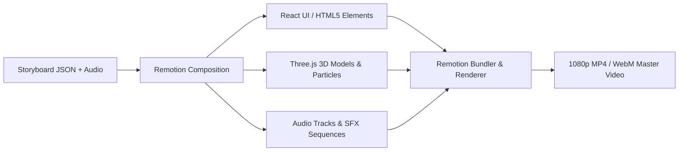

# Remotion Skill (Code-Based Motion Graphics & Video)

This skill provides comprehensive instructions, patterns, and automation workflows for programmatically generating, editing, and rendering videos using **Remotion** (`remotion.dev`), React, and Three.js inside Google Anti-gravity.

---

## 1. Overview & Core Architecture

Remotion allows developers and AI agents to create video compositions using standard React and web technologies:
- **Frame-by-frame rendering**: Time is represented in discrete frames (`useCurrentFrame()`, `useVideoConfig()`).
- **Mathematical transitions**: `interpolate()`, `spring()`, and bezier curves for motion graphics.
- **3D Graphics with Three.js**: Render 3D animated meshes, stars, particles, and cartoon characters using `@react-three/fiber` and `@remotion/three`.
- **Dynamic Data Ingestion**: Pass JSON storyboards, lyrics, subtitles, and audio assets as React props.
- **Headless CLI Rendering**: Preview live via `npm run dev` and render master MP4s via `npx remotion render`.



---

## 2. Setting Up a Remotion Project

### Initialize Project:
```bash
npx create-video@latest remotion-video --template blank
cd remotion-video
npm install three @types/three @react-three/fiber @remotion/three
```

### Remotion Root (`src/Root.tsx`):
```tsx
import React from 'react';
import { Composition } from 'remotion';
import { PreschoolSongComposition } from './PreschoolSongComposition';

export const Root: React.FC = () => {
  return (
    <Composition
      id="PreschoolSong"
      component={PreschoolSongComposition}
      durationInFrames={30 * 60} // 60 seconds at 30fps
      fps={30}
      width={1920}
      height={1080}
      defaultProps={{
        title: "The Rainbow Paintbox Song",
        characterName: "Barnaby Bear",
        primaryColor: "#00A896"
      }}
    />
  );
};
```

---

## 3. Kinetic Typography & Bouncing Subtitles

In preschool videos, toddlers learn best when words bounce in sync with the song rhythm:

```tsx
import { useCurrentFrame, useVideoConfig, spring, interpolate } from 'remotion';

export const BouncingWord: React.FC<{ word: string; delayFrame: number }> = ({ word, delayFrame }) => {
  const frame = useCurrentFrame();
  const { fps } = useVideoConfig();

  const entrance = spring({
    frame: frame - delayFrame,
    fps,
    config: { damping: 10, stiffness: 120 }
  });

  const scale = interpolate(entrance, [0, 1], [0.4, 1.2]);
  const opacity = interpolate(entrance, [0, 1], [0, 1]);

  return (
    <span
      style={{
        display: 'inline-block',
        marginRight: 16,
        transform: `scale(${scale})`,
        opacity,
        fontFamily: 'Fredoka, Arial Rounded MT Bold',
        fontSize: 72,
        color: '#FFD166',
        textShadow: '4px 4px 0 #1D3557, -4px -4px 0 #1D3557, 4px -4px 0 #1D3557, -4px 4px 0 #1D3557'
      }}
    >
      {word}
    </span>
  );
};
```

---

## 4. Integrating Three.js (`@remotion/three`) for 3D Elements

Remotion supports 3D elements inside videos via Three.js canvas components:

```tsx
import React, { useRef } from 'react';
import { ThreeCanvas } from '@remotion/three';
import { useCurrentFrame } from 'remotion';
import * as THREE from 'three';

const SpinningStar: React.FC = () => {
  const meshRef = useRef<THREE.Mesh>(null);
  const frame = useCurrentFrame();

  if (meshRef.current) {
    meshRef.current.rotation.y = frame * 0.05;
    meshRef.current.position.y = Math.sin(frame * 0.1) * 0.3;
  }

  return (
    <mesh ref={meshRef}>
      <octahedronGeometry args={[1, 0]} />
      <meshStandardMaterial color="#FFCA3A" emissive="#FF9F1C" roughness={0.2} />
    </mesh>
  );
};

export const ThreeStageOverlay: React.FC = () => {
  return (
    <div style={{ position: 'absolute', inset: 0, pointerEvents: 'none' }}>
      <ThreeCanvas width={1920} height={1080}>
        <ambientLight intensity={0.8} />
        <directionalLight position={[10, 10, 5]} intensity={1.5} />
        <SpinningStar />
      </ThreeCanvas>
    </div>
  );
};
```

---

## 5. Automated Rendering Commands in Anti-gravity

Anti-gravity agents can execute Remotion rendering directly from terminal:

```bash
# 1. Start Remotion Preview Server (Local interactive studio)
npm run dev

# 2. Render Single Still / Thumbnail at Frame 60
npx remotion still PreschoolSong out/thumbnail.jpg --frame=60

# 3. Render 1080p MP4 with Hardware Acceleration
npx remotion render PreschoolSong out/final_video.mp4 --props='{"title":"Learn Colors"}' --concurrency=4
```
